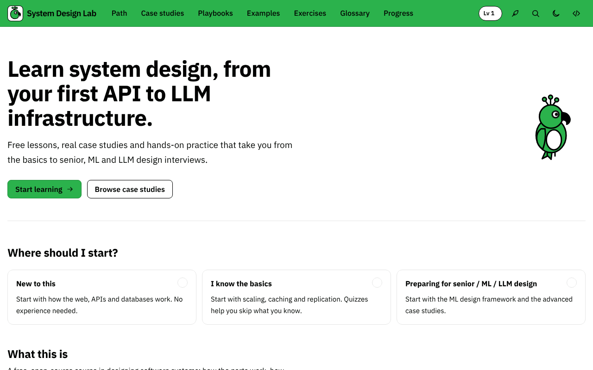

# System Design Lab

A free, open-source place to learn system design, from how a web request works to serving large language models. Short lessons, step-by-step playbooks, worked examples and 50 case studies, each with quizzes and estimation drills. It's written so a beginner can start at the first page and an experienced engineer can jump straight to the deep dives.

**Live site:** https://peaceful-developer.github.io/master-system-design/




## What's inside

- **A learning path in six phases:** foundations, distributed-systems building blocks, data systems, ML systems, LLM systems and frontier infrastructure. See [docs/curriculum.md](docs/curriculum.md) for every planned lesson.
- **Lessons** layered for every level: a "New to this?" primer, the main explanation, "Go deeper" sections for experts and interview tips.
- **Playbooks:** repeatable methods for the system design interview, back-of-envelope estimation and ML system design.
- **Worked examples:** one pattern each (cache-aside, fan-out on write, two-tower retrieval, RAG), with a diagram.
- **50 case studies in three tracks:** classic systems, ML systems and LLM/GenAI systems. Complete case studies follow a 12-part template, from requirements and estimates to failure modes and a 45-minute interview talk track; the rest are outlines that are open for contributions.
- **Quizzes and estimation drills** with explanations and worked solutions.
- **A glossary** of every term, linked from the text.
- **Progress, XP and streaks**, saved in your browser only. There are no accounts and no tracking.
- **Search** across everything (press <kbd>/</kbd>, or <kbd>Ctrl</kbd>+<kbd>K</kbd> / <kbd>⌘</kbd>+<kbd>K</kbd>).

A drawing canvas and a load simulator are planned for a later release; the [Playground](https://peaceful-developer.github.io/master-system-design/playground) already shows the components they will use.

## Quick start

You need [Node.js](https://nodejs.org/) 24 (see `.nvmrc`).

```bash
git clone https://github.com/peaceful-developer/master-system-design.git
cd master-system-design
npm ci
npm start
```

Then open http://localhost:4200. Edits to files in `content/` reload in the browser.

## Scripts

| Command | What it does |
| --- | --- |
| `npm start` | Builds the content, then runs the dev server with content watching |
| `npm run build` | Builds the content and a production build with every page prerendered to static HTML |
| `npm run serve` | Serves the production build from `dist/` |
| `npm run validate-content` | Checks every content file against the schemas and cross-reference rules, without building |
| `npm test` | Runs the app unit tests and the content pipeline tests |
| `npm run e2e` | Runs the Playwright end-to-end tests against the production build in `dist/` (run `npm run build` first) |
| `npm run lint` | ESLint, Prettier and a type check of the build scripts |
| `npm run figures:render` | Renders every figure in light, dark and reduced-motion modes to PNGs for visual review |
| `npm run demo:capture` | Records `docs/demo.gif` and `docs/screenshot.png` from a running production build (`npm run serve`) |

## How the content is organized

All learning content is Markdown and JSON in `content/`, checked by the build:

```text
content/
  lessons/<phase>/<slug>.md     lessons, one folder per phase
  playbooks/<slug>.md           step-by-step methods
  examples/<slug>.md            worked examples
  case-studies/<slug>/          index.md and diagram.json for each case study
  quizzes/<id>.json             multiple-choice quizzes
  drills/<id>.json              estimation drills
  diagrams/<id>.json            diagrams used by examples
  figures/<id>.svg              hand-drawn SVG figures (CSS-animated)
  icons/<name>.svg              diagram component icons
  components.json               the diagram component catalog
  glossary.json                 every term, with definitions
  path.json                     the learning path: phases and their order
  _templates/                   starting points for each content type
```

The build turns these into typed JSON for the Angular app and fails with the file and field named if anything is invalid. There is no server or database: the whole site is static files.

## Built with

Angular 22 (standalone components, signals, zoneless change detection, static prerendering), Tailwind CSS 4, Vitest, Playwright, Zod, unified/remark and MiniSearch.

## Contributing

Corrections, new lessons and expanded case studies are very welcome. Read [CONTRIBUTING.md](CONTRIBUTING.md) to get started; the outlines and the planned lessons in [docs/curriculum.md](docs/curriculum.md) are good first contributions. Everyone taking part is expected to follow the [Code of Conduct](CODE_OF_CONDUCT.md).

## License

- **Code** is licensed under the [MIT License](LICENSE).
- **Learning content** (everything in `content/`) is licensed under [Creative Commons Attribution 4.0](LICENSE-CONTENT): you may share and adapt it, including commercially, as long as you credit "System Design Lab contributors" and link to this project.
